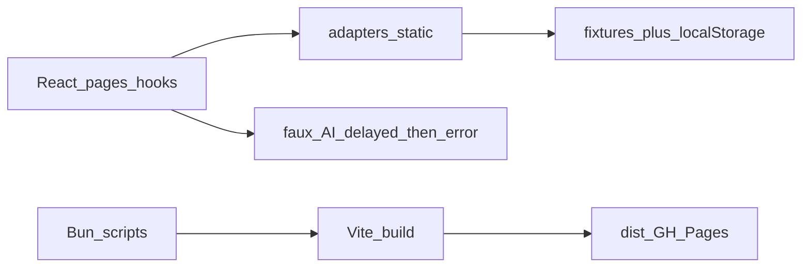

# Static demo shell (donor #1)

## Decisions locked

- **Working target:** Full visual upstream UI with **demo sample data**, browser-persisted mutations where cheap. Add on top later; do not simplify visuals.
- **Parent:** Do not touch FamilyBizness parent. This is silo donor #1 of 6–9.
- **No git:** Delete `.git` / remotes; record fetch datetime in `NOTICE.md` only.
- **License/attribution only:** The string **Wealthfolio** may remain in `LICENSE`, `NOTICE.md`, `TRADEMARKS.md` (attribution). It must **not** remain in application code, feature folders, import paths, logo path strings, package names, UI product strings, or identifiers.
- **Tooling:** **Bun + Vite coexist** — Bun owns install/scripts/test/serve; Vite remains the bundler (enhanced/config cleaned for static-only, no Tauri).

## Live integrations policy

| Area | Action |
|------|--------|
| **Connect** (`features/wealthfolio-connect`, settings Connect pages, providers, deeplinks, env keys) | **Delete entirely** — no stubs, no “disabled” flags, no leftover `wealthfolio` Connect symbols |
| **MCP / agent-access** | **Delete entirely** |
| **Cloud backups** | **Delete entirely** |
| **AI chat** | **Keep UI temporarily** as **faux demo** (other donor will replace later) |

### Faux AI behavior

1. User picks among **multiple hardcoded option prompts** (chips/buttons), not a free-form production agent.
2. On send: show a **delayed fake “reasoning” stream** (typed/chunked filler text for effect).
3. Then always surface a **hardcoded delightful failure**: technical-sounding issue + error message body (fixed copy), as if the request exploded amusingly — regardless of which option / user input was chosen (user free-text, if allowed, still ends in the same delightful hardcoded error).

No real model calls, no streaming to a backend.

## Architecture after cut

## Delete (high volume)

- `apps/tauri/`, `apps/server/`, `crates/`, Cargo root files, `rust-toolchain.toml`, `clippy.toml`
- `.git/`
- MCP / agent-access pages, adapters, types, tests
- Cloud backup pages, adapters, commands, tests
- Entire Connect feature tree and all imports/routes/nav entries
- `packaging/`, Tauri scripts, server `dev:web` orchestration, server-bound e2e
- Addon sandbox / `addon-dev-tools` if only needed for live addons (drop unless blocking UI)
- Residual Docker/CI that assumes Rust/server (trim or remove `.github` until a Pages workflow is added later)

**Keep:** `apps/frontend` (minus deleted features), `packages/ui`, AGPL + attribution docs.

## Core refactor

1. **Static adapter** (`adapters/static` or slimmed `web`): `invoke` → fixtures + `localStorage`; empty stubs only for leftover non-deleted commands that pages still call.
2. **Boot** ([`App.tsx`](apps/frontend/src/App.tsx)): remove AuthGate / NativeDatabaseGate / Connect provider wiring; default demo profile; land on dashboard.
3. **Code scrub — Wealthfolio:** rename product strings to FamilyBizness; rename paths like `features/wealthfolio-connect` (deleted), logo imports `/logo.png` keep files but purge any `wealthfolio` path segments, i18n keys, CSS/localStorage keys (`wealthfolio-theme` → neutral keys), package `@wealthfolio/*` → local aliases (e.g. `@fb/ui` or path aliases to `packages/ui`) so the word does not appear in code.
4. **Vite + Bun:** root `package.json` / `bunfig` scripts call Vite; remove Tauri `BUILD_TARGET` branch; static `base` for GH Pages; Bun runs Vitest where practical.
5. **Faux AI:** implement as above inside remaining AI assistant feature.

## Proprietary / trademark scrub

- Logos already placeholder; ensure **code** has no Wealthfolio logo path names.
- Drop ticker/brokerage logo packs if still present; use initials/avatars.
- No Connect/updater/MCP secrets left in env examples.

## Provenance without git

`NOTICE.md`: upstream URL + **exact local fetch datetime**, then delete `.git`. Attribution may say Wealthfolio; code must not.

## Out of scope

- Parent monorepo / cross-donor Frankenstein navigation.
- Replacing faux AI with the better donor later.
- Real backend.

## Success criteria

- `bun run dev` / `bun run build` → browser demo UI with sample portfolio.
- No Rust, Tauri, Docker, Connect, MCP, cloud backup code.
- Grep of app/source (excluding LICENSE/NOTICE/TRADEMARKS): **no** `wealthfolio` / `Wealthfolio`.
- AI: option chips → fake delayed reasoning → hardcoded delightful technical error.
- No `.git`.
